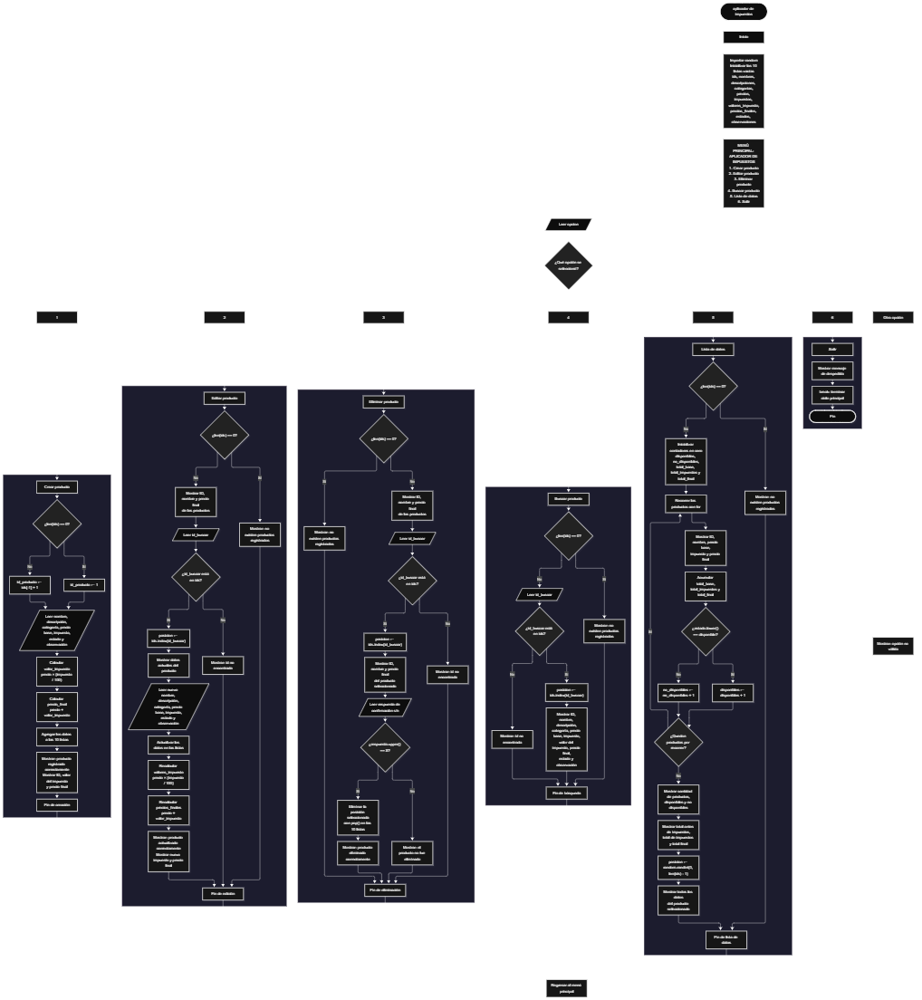

Este proyecto, llamado <b>aplicador de impuestos</b>, fue desarrollado en <b>python</b> como un ejercicio práctico para fortalecer la lógica de programación mediante la creación de un sistema de gestión de productos desde la consola. El programa cuenta con un menú principal de seis opciones que permite <b>crear, editar, eliminar, buscar y listar productos, además de consultar sus estadísticas</b>. Cada producto almacena datos como el nombre, la descripción, la categoría, el precio base, el porcentaje de impuesto, el valor del impuesto, el precio final, el estado y las observaciones. Para organizar la información, se utilizan diez listas paralelas que mantienen los datos relacionados mediante un identificador y una posición común durante la ejecución. Durante su desarrollo se aplicaron conceptos fundamentales de programación, como variables, listas, estructuras condicionales, ciclos repetitivos, estructuras de selección, operaciones aritméticas, búsqueda de registros y selección aleatoria mediante el módulo <b>random</b>. Este proyecto permite poner en práctica los conocimientos adquiridos en Python y sirve como base para desarrollar sistemas de gestión más avanzados utilizando otros lenguajes y tecnologías.

<h2 align="center">⚙️ Funcionamiento del menú principal</h2>

### ➕ Crear producto

La opción <b>1) crear producto</b> permite registrar un nuevo producto en el sistema. Antes de realizar el registro, el programa comprueba si existen productos almacenados mediante la lista <b>ids</b>. Si la lista está vacía, asigna el identificador <b>1</b> al primer producto. De lo contrario, genera el nuevo identificador sumando uno al último valor almacenado mediante la expresión <b>ids[-1] + 1</b>. Después, solicita el <b>nombre, la descripción, la categoría, el precio base, el porcentaje de impuesto, el estado y la observación</b>. El precio base y el porcentaje de impuesto se convierten a valores numéricos de tipo <b>float</b> para realizar los cálculos correspondientes. A continuación, calcula el valor del impuesto mediante la fórmula <b>precio * (impuesto / 100)</b> y obtiene el precio final sumando el impuesto al precio base. Finalmente, almacena todos los datos en sus respectivas listas y muestra el mensaje <b>"producto registrado correctamente."</b>, junto con el identificador, el valor del impuesto y el precio final. El programa conserva la información únicamente durante la ejecución actual.

### ✏️ Editar producto

La opción <b>2) editar producto</b> permite modificar los datos de un producto registrado. Primero, el programa comprueba si existen productos almacenados mediante la lista <b>ids</b>. Si no hay registros, muestra el mensaje <b>"no existen productos registrados."</b>. En caso contrario, presenta una lista con el identificador, el nombre y el precio final de cada producto. Después, solicita el identificador del producto que se desea editar y comprueba si se encuentra dentro de la lista <b>ids</b>. Si existe, utiliza el método <b>index()</b> para obtener la posición correspondiente y muestra los datos actuales del producto. A continuación, solicita el nuevo nombre, la descripción, la categoría, el precio base, el porcentaje de impuesto, el estado y la observación, actualizando los valores de las listas correspondientes. Una vez modificados los datos, vuelve a calcular el valor del impuesto y el precio final utilizando los nuevos valores del precio base y del porcentaje de impuesto. Finalmente, presenta el mensaje <b>"producto actualizado correctamente."</b> y muestra el nuevo valor del impuesto y el precio final. Si el identificador no existe, muestra el mensaje <b>"id no encontrada."</b>.

### 🗑️ Eliminar producto

La opción <b>3) eliminar producto</b> permite eliminar un producto registrado mediante su identificador. Antes de comenzar, el programa comprueba si existen productos almacenados. Si no hay registros, muestra el mensaje <b>"no existen productos registrados."</b>. Si existen productos, presenta una lista con el identificador, el nombre y el precio final de cada uno. Después, solicita el identificador del producto que se desea eliminar y comprueba si se encuentra en la lista <b>ids</b>. Si el producto existe, obtiene su posición mediante <b>ids.index(id_buscar)</b>, muestra sus datos y solicita confirmación con el mensaje <b>"¿desea eliminar este producto? (s/n):"</b>. Cuando la respuesta, convertida a mayúsculas mediante <b>upper()</b>, es igual a <b>"S"</b>, el programa elimina la información de la posición correspondiente utilizando el método <b>pop()</b> en las diez listas: <b>ids, nombres, descripciones, categorias, precios, impuestos, valores_impuesto, precios_finales, estados y observaciones</b>. De esta manera, mantiene sincronizados los datos de los productos restantes. Finalmente, muestra el mensaje <b>"producto eliminado correctamente."</b>. Si la respuesta no es S, muestra <b>"el producto no fue eliminado."</b>. Si el identificador no existe, informa que el ID no fue encontrado.

### 🔎 Buscar producto

La opción <b>4) buscar producto</b> permite localizar un producto mediante su identificador. Primero, comprueba si existen productos registrados. Si la lista <b>ids</b> está vacía, muestra el mensaje <b>"no existen productos registrados."</b>. En caso contrario, solicita el identificador del producto que se desea buscar y verifica si está presente en la lista. Cuando encuentra una coincidencia, utiliza <b>ids.index(id_buscar)</b> para obtener la posición del registro y mostrar toda su información: <b>identificador, nombre, descripción, categoría, precio base, porcentaje de impuesto, valor del impuesto, precio final, estado y observación</b>. Los valores monetarios se presentan con dos decimales mediante la función <b>format()</b>. Si el identificador no se encuentra en la lista, muestra el mensaje <b>"id no encontrada."</b>. Esta función facilita consultar los datos completos de un producto sin necesidad de recorrer manualmente todos los registros.

### 📋 Lista de datos y estadísticas

La opción <b>5) lista de datos</b> permite visualizar los productos registrados y obtener estadísticas generales sobre ellos. Primero, el programa comprueba si existen productos almacenados. Si no hay registros, muestra el mensaje <b>"no existen productos registrados."</b>. Si existen productos, inicializa las variables <b>disponibles, no_disponibles, total_base, total_impuestos y total_final</b> en cero. Después, utiliza un ciclo <b>for</b> para recorrer las listas y mostrar el identificador, el nombre, el precio base, el porcentaje de impuesto y el precio final de cada producto. Durante el recorrido, acumula el precio base en <b>total_base</b>, el valor del impuesto en <b>total_impuestos</b> y el precio final en <b>total_final</b>. También comprueba el estado de cada producto mediante <b>estados[i].lower() == "disponible"</b>. Si se cumple la condición, incrementa el contador de productos disponibles; en caso contrario, incrementa el contador de productos no disponibles. Al finalizar, muestra la cantidad total de productos, los productos disponibles y no disponibles, el valor total antes de impuestos, el valor total de los impuestos y el valor total con impuestos. Finalmente, utiliza <b>random.randint(0, len(ids) - 1)</b> para seleccionar una posición aleatoria y mostrar toda la información del producto seleccionado.

### 🚪 Salir del menú principal

La opción <b>6) salir</b> permite finalizar la ejecución del programa. Cuando el usuario selecciona esta opción, el sistema muestra el mensaje <b>"gracias por utilizar el aplicador de impuestos."</b> y ejecuta la instrucción <b>break</b>, que interrumpe el ciclo <b>while True</b> del menú principal. De esta manera, el programa termina su ejecución después de mostrar el mensaje de despedida. Si el usuario introduce una opción diferente de las comprendidas entre 1 y 6, el sistema ejecuta el bloque <b>else</b> correspondiente a la selección del menú y muestra el mensaje <b>"opción no válida."</b>, permitiendo volver al menú principal.

<h2 align="center">🧠 Temas aplicados en el proyecto</h2>

### 📦 Variables

En este proyecto se utilizan variables para almacenar los datos introducidos por el usuario, controlar las operaciones del menú, localizar productos, calcular los impuestos y obtener las estadísticas generales. Cada variable cumple una función específica dentro del sistema de gestión de productos.

🔢 **Opcion:** Almacena la opción seleccionada por el usuario en el menú principal.

🆔 **Id_producto:** Almacena el identificador asignado al nuevo producto durante el registro.

🔎 **Id_buscar:** Almacena el identificador introducido por el usuario para localizar un producto.

📍 **Posicion:** Indica la posición del producto encontrado dentro de las listas.

💰 **Precio:** Almacena el precio base del producto.

📊 **Impuesto:** Almacena el porcentaje de impuesto aplicado al precio base.

🧮 **Valor_impuesto:** Almacena el importe monetario calculado a partir del precio base y el porcentaje de impuesto.

💵 **Precio_final:** Almacena el resultado de sumar el valor del impuesto al precio base.

🔄 **I:** Funciona como contador en los ciclos utilizados para recorrer las listas de productos.

📈 **Total_base:** Acumula el valor de los precios base de todos los productos registrados.

🧾 **Total_impuestos:** Acumula el valor de los impuestos calculados para los productos.

💰 **Total_final:** Acumula el valor de los precios finales, incluidos los impuestos.

📦 **Disponibles:** Cuenta los productos cuyo estado es igual a "disponible", sin distinguir entre mayúsculas y minúsculas.

📋 **No_disponibles:** Cuenta los productos cuyo estado no coincide con "disponible".

🎲 **Posicion:** También se utiliza para almacenar la posición seleccionada aleatoriamente durante la opción de estadísticas y mostrar los datos del producto elegido.

### 🗃️ Listas

En este proyecto se utilizan diez listas paralelas para almacenar los datos de los productos. Todas mantienen una relación mediante el índice: los elementos que ocupan una misma posición corresponden al mismo producto. Por ejemplo, los datos de un producto ubicado en la posición <b>0</b> se encuentran distribuidos entre <b>ids[0], nombres[0], precios[0], impuestos[0]</b> y las demás listas. Esta organización permite recorrer, buscar, modificar y eliminar registros manteniendo relacionados sus datos. A diferencia de los arreglos de capacidad fija, estas listas pueden aumentar o disminuir su tamaño durante la ejecución.

🆔 **Ids:** Almacena los identificadores de los productos.

📝 **Nombres:** Almacena los nombres de los productos registrados.

📄 **Descripciones:** Almacena las descripciones de los productos.

🏷️ **Categorias:** Almacena las categorías de los productos.

💵 **Precios:** Almacena los precios base antes de aplicar los impuestos.

📊 **Impuestos:** Almacena los porcentajes de impuesto correspondientes a cada producto.

🧾 **Valores_impuesto:** Almacena los valores monetarios de los impuestos calculados.

💰 **Precios_finales:** Almacena los precios finales, incluidos los impuestos.

📦 **Estados:** Almacena los estados de disponibilidad de los productos.

📋 **Observaciones:** Almacena las observaciones adicionales de cada producto.

### 🔀 Estructuras condicionales

En este proyecto se utilizan las estructuras <b>if, elif y else</b> para controlar las decisiones del programa. Estas estructuras permiten seleccionar las operaciones del menú, comprobar si existen productos registrados, determinar si un identificador está presente en la lista <b>ids</b>, confirmar o cancelar la eliminación de un producto y clasificar los productos según su estado. También permiten comprobar si las listas están vacías antes de ejecutar las operaciones que necesitan registros almacenados. De esta manera, el programa responde según las condiciones encontradas durante la ejecución.

### 🔄 Estructuras repetitivas

En este proyecto se utilizan las estructuras repetitivas <b>while</b> y <b>for</b>. El ciclo <b>while True</b> mantiene activo el menú principal y permite ejecutar diferentes operaciones hasta que se selecciona la opción de salida, que utiliza <b>break</b> para finalizar el ciclo. Por su parte, los ciclos <b>for</b> recorren las listas para mostrar los productos, presentar los registros disponibles antes de editar o eliminar, y calcular las estadísticas generales. Estas estructuras permiten repetir instrucciones sin necesidad de escribir manualmente el mismo código para cada producto.

### 🎯 Estructura de selección del menú

El programa utiliza una cadena de decisiones formada por <b>if, elif y else</b> para evaluar el valor almacenado en la variable <b>opcion</b>. Cada condición corresponde a una operación específica del sistema: crear, editar, eliminar, buscar, listar los datos o salir. El bloque <b>else</b> se ejecuta cuando el valor introducido no coincide con ninguna de las seis opciones disponibles y muestra el mensaje <b>"opción no válida."</b>. Esta estructura organiza las operaciones y permite que el usuario seleccione la funcionalidad que desea ejecutar.

### 🆔 Generación de identificadores

El sistema genera automáticamente un identificador para cada producto registrado. Cuando la lista <b>ids</b> está vacía, asigna el valor <b>1</b>. Cuando ya existen productos, toma el último identificador almacenado mediante <b>ids[-1]</b> y le suma uno. Esta operación evita solicitar manualmente el identificador al usuario y permite distinguir los registros durante las búsquedas, modificaciones y eliminaciones. Sin embargo, como el cálculo depende del último elemento de la lista, el identificador del último producto eliminado puede volver a utilizarse si se registra un nuevo producto posteriormente.

### 🧮 Operaciones aritméticas

El programa utiliza operaciones aritméticas para calcular el importe de los impuestos y el precio final de cada producto. El valor del impuesto se obtiene multiplicando el precio base por el porcentaje dividido entre cien. Después, el precio final se calcula sumando el importe del impuesto al precio base. Estas operaciones se realizan tanto durante el registro como durante la edición de productos, garantizando que los valores calculados se actualicen cuando se modifica el precio o el porcentaje de impuesto.

**Fórmulas utilizadas:**

- **Valor del impuesto:** `precio * (impuesto / 100)`.
- **Precio final:** `precio + valor_impuesto`.

### 🔍 Búsqueda mediante identificadores

La búsqueda de productos se realiza utilizando el identificador almacenado en la lista <b>ids</b>. El operador <b>in</b> permite comprobar si el identificador introducido existe en la lista. Cuando se encuentra una coincidencia, el método <b>index()</b> devuelve la posición del identificador, que se utiliza para acceder a los datos correspondientes en las demás listas. Este procedimiento se aplica en las operaciones de edición, eliminación y consulta de productos.

### 🎲 Selección aleatoria

El proyecto importa el módulo <b>random</b> para seleccionar aleatoriamente un producto durante la opción de lista de datos y estadísticas. La instrucción <b>random.randint(0, len(ids) - 1)</b> genera un número entero entre la primera posición válida y la última posición ocupada de las listas. El número obtenido se almacena en la variable <b>posicion</b> y permite mostrar los datos completos del producto seleccionado. Esta operación se ejecuta cuando existen productos registrados, por lo que el programa comprueba previamente que la lista no esté vacía.

### 💲 Formato de valores monetarios

El programa utiliza la función <b>format()</b> y la especificación <b>".2f"</b> para presentar los valores monetarios con dos cifras decimales. Esta forma de presentación se aplica al valor del impuesto, al precio final y a los totales estadísticos. También se utilizan cadenas formateadas mediante <b>f-strings</b> para mostrar de manera ordenada el identificador, el nombre, el precio base, el porcentaje de impuesto y el precio final de cada producto.

### 🔠 Normalización de texto

El programa utiliza los métodos <b>upper()</b> y <b>lower()</b> para normalizar determinados valores de texto antes de compararlos. Durante la eliminación, <b>upper()</b> convierte la respuesta del usuario a mayúsculas para comprobar si corresponde a <b>"S"</b>. En las estadísticas, <b>lower()</b> convierte el estado del producto a minúsculas para comparar el valor con <b>"disponible"</b>. Estas operaciones permiten reconocer diferentes combinaciones de mayúsculas y minúsculas en esas comparaciones específicas.

<h2 align="center">¿Cómo se implementaron las operaciones crud en el proyecto?</h2>

Las operaciones <b>crud</b> se implementaron mediante las opciones del menú principal, permitiendo administrar los productos registrados. La operación <b>crear</b> corresponde a <b>crear producto</b>, donde se introducen los datos y se calculan los impuestos; <b>leer</b> se realiza mediante las opciones <b>buscar producto y lista de datos</b>, que permiten consultar registros individuales o visualizar la información general; <b>actualizar</b> corresponde a <b>editar producto</b>, donde se modifican los datos y se recalculan los valores monetarios; y <b>eliminar</b> se realiza mediante la opción <b>eliminar producto</b>, que retira el registro de todas las listas relacionadas. Estas operaciones utilizan identificadores, listas paralelas, condicionales, ciclos y métodos de listas para administrar la información durante la ejecución del programa.

<h2 align="center">Diagrama de flujo del proyecto</h2>

<h2 align="center">🛡️ Validaciones del programa</h2>

### 📭 No existen productos registrados

Esta comprobación se utiliza en las opciones de <b>editar, eliminar, buscar y lista de datos</b>. El programa comprueba si la lista <b>ids</b> está vacía mediante la condición <b>len(ids) == 0</b>. Si no existen productos registrados, muestra el mensaje <b>"no existen productos registrados."</b> y evita continuar con la operación que requiere datos almacenados. Esta comprobación también evita que la opción de estadísticas intente seleccionar un producto aleatorio cuando no existen registros.

### 🔎 Identificador no encontrado

Esta comprobación se utiliza en las operaciones de <b>editar, eliminar y buscar producto</b>. El programa comprueba si el identificador introducido se encuentra en la lista <b>ids</b> mediante la condición <b>id_buscar in ids</b>. Si existe, obtiene la posición correspondiente y continúa con la operación solicitada. Si no existe, muestra el mensaje <b>"id no encontrada."</b>. De esta forma, el sistema evita modificar, eliminar o mostrar información de un producto cuyo identificador no está registrado.

### 🗑️ Confirmación de eliminación

Durante la eliminación, el programa solicita confirmación mediante la pregunta <b>"¿desea eliminar este producto? (s/n):"</b>. La respuesta se convierte a mayúsculas con <b>respuesta.upper()</b> y se compara con el valor <b>"S"</b>. Si coincide, elimina el registro de las diez listas. Si la respuesta es diferente, muestra el mensaje <b>"el producto no fue eliminado."</b>. Esta comprobación permite cancelar la eliminación, aunque no valida explícitamente que la respuesta introducida sea únicamente S o N.

### 📦 Clasificación de productos disponibles

En la opción de estadísticas, el programa comprueba el estado de cada producto mediante la condición <b>estados[i].lower() == "disponible"</b>. Si el estado coincide con la palabra "disponible", incrementa el contador <b>disponibles</b>. En caso contrario, incrementa <b>no_disponibles</b>. Esta comprobación no limita los valores que el usuario puede introducir durante el registro o la edición; por lo tanto, cualquier estado diferente de "disponible" se contabiliza como no disponible.

### ⚠️ Opción no válida

La estructura condicional del menú incluye un bloque <b>else</b> que se ejecuta cuando el valor introducido no coincide con las opciones comprendidas entre <b>1 y 6</b>. En ese caso, el programa muestra el mensaje <b>"opción no válida."</b> y vuelve al inicio del ciclo principal. Esta respuesta permite informar al usuario cuando selecciona una opción que no está definida en el menú.

### ⚠️ Validación de datos numéricos

El programa convierte las entradas del precio base y del porcentaje de impuesto mediante la función <b>float()</b>, mientras que los identificadores introducidos para las operaciones de edición, eliminación y búsqueda se convierten mediante <b>int()</b>. Sin embargo, el código actual no incluye bloques <b>try/except</b> para controlar entradas no numéricas ni validaciones explícitas para impedir precios negativos o porcentajes de impuesto fuera de un rango determinado. Por este motivo, se espera que el usuario introduzca valores compatibles con las conversiones solicitadas.

<h2 align="center">🎯 Objetivo del proyecto</h2>

El objetivo principal de este proyecto es fortalecer la <b>lógica de programación</b> mediante el desarrollo de un sistema de gestión de productos en <b>python</b>. A través de su construcción se busca aplicar los conocimientos adquiridos sobre variables, listas, estructuras condicionales, ciclos repetitivos, operaciones aritméticas, búsqueda de registros y estructuras de selección. Además, el proyecto permite comprender cómo registrar, consultar, modificar y eliminar información, calcular impuestos sobre los precios base y obtener estadísticas sobre los productos administrados. De esta manera, se establece una base para desarrollar sistemas de gestión más completos y aplicar los mismos conceptos en otros lenguajes y tecnologías.

